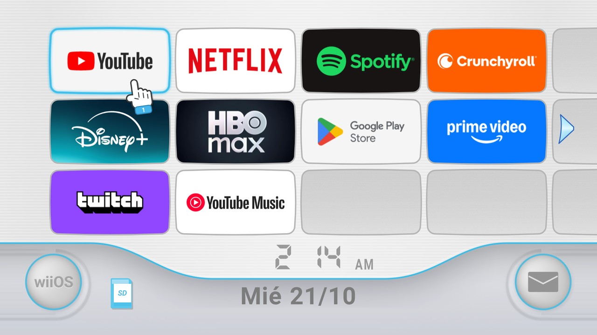

# wii-tv

The Wii channel menu as the home screen of your Android TV.



wii-tv replaces the home screen of an Android TV with a menu in the style of the Wii Menu: twelve channels to a page, the segment clock, the date, the round buttons, a pointing hand that follows your selection and sounds as you move. Each channel is one of your apps, with its own banner. When the TV turns on, a white notice screen comes up, as on the console, and OK takes you to the menu.

Español: [README.es.md](README.es.md)

## This edition: streaming sticks and extra features

This repository is [MauroProto/wii-tv](https://github.com/MauroProto/wii-tv) with the same look, extended for **streaming sticks and boxes** (Fire TV Stick, onn. 4K / 4K Pro, Chromecast with Google TV and other Google TV / Android TV devices), plus a few features of its own.

**→ Step-by-step setup for making it your home screen: [docs/streaming-stick-setup.md](docs/streaming-stick-setup.md)**
**→ 2020–2022 Fire TV Stick (3rd Gen, Lite, 4K Max 1st Gen): [docs/fire-tv-stick-2021.md](docs/fire-tv-stick-2021.md)**
**→ Which devices it runs on (and which it can't): [docs/devices.md](docs/devices.md)**

What's added on top of upstream:

- **Fire TV support.** Fire OS won't hand Home to another app, so the `FireTvHomeService` accessibility service takes the Home button (hold it for Settings) and puts the menu back whenever the Amazon home appears. The install script detects a Fire TV and sets this up without disabling anything.
- **Rearrange and hide channels from the remote.** Hold OK on a channel (or press ☰ on a Fire TV remote) for **Move**, **Hide channel** and **App info**. In Move the channel lifts and follows the arrows until you press OK. The order and hidden list are saved on the device.
- **wiiOS Settings.** A full-screen settings screen in the style of the Wii's (big buttons, page arrows, Back) with the device's own settings built in: Display & Picture, Sound & Speakers, Network & Wi-Fi, Remotes, Controllers & Bluetooth, Captions, Screensaver & Sleep, Language, HDMI inputs, Date & Time, Accessibility, Apps, Storage, About. Each one opens the system's own page, so networking, Bluetooth and picture settings are the device's, not reimplemented.
- **English by default, 20+ languages to choose from.** The menu stays English whatever the device language is; Settings → Language switches it on the spot.
- **Now Playing screensaver.** Blurred album colours behind the artwork, title, artist and progress of whatever's playing (Spotify, podcasts…), plus the clock. It drifts against burn-in and can fade to black while the audio plays on. Screensaver and sleep timers can be set from wiiOS Settings.
- **Over-the-air updates.** CI publishes every build of `main` as a GitHub release, and the menu installs newer builds itself (Settings → System Update), so the computer is only needed once.
- **Forecast Channel.** A built-in channel with live weather on its tile and a full forecast screen (Open-Meteo, no API key; location automatic or by city).
- **Game controllers as the remote.** Xbox, PlayStation and other Bluetooth gamepads: A = OK, B = Back, Y = channel options, LB/RB turn the page, Start opens Settings.
- **Background music.** An original, gentle menu loop that's synthesised on the device (`MenuMusic.java`), so the APK carries no audio file and stays under 800 KB. Can be switched off in the wiiOS menu.
- **Message Board.** On a stick, which has no HDMI inputs, the envelope lists the channels you opened most recently. On a TV they follow the inputs.
- **Stick-friendly SD button.** Opens the first installed media or file app (Kodi, VLC, X-plore, Files…; `sd_apps` in `config.xml`).
- **Sideloaded apps get channels too.** Apps with only a phone-style launcher entry are included, and TV banners are used when an app has one.
- **Install without building.** CI attaches a ready APK to every run; `APK_FILE=app-release.apk TV_HOST=<ip> launcher/build-and-install.sh` installs it with no JDK or Android SDK.

## Disclaimer

wii-tv is a fan project. It is not affiliated with or endorsed by Nintendo. "Wii" is a trademark of Nintendo.

The repository contains nothing from Nintendo: no logos, fonts, images or sounds. Everything on screen is drawn in code (`WiiMenuView`, `WiiBase`, `WiiPalette`), and the sounds are synthesised by `tools/sounds/make_sounds.py`.

## Features

- **Channels**: 4 columns by 3 rows per page. The first column of the next page shows at the right edge, and the arrows turn the page. Your apps fill the channels; the rest stay empty.
- **Clock and date**: a 12-hour segment clock with AM/PM, and the short date in the TV's language.
- **Bottom buttons**:
  - **wiiOS** (left) opens Android TV Settings.
  - **SD** opens the TV's media player (USB drives).
  - **Envelope** (right) lists the HDMI inputs and live TV.
- **Pointing hand** that follows the selected channel or button.
- **Sounds** for moving, opening, turning the page, opening the inputs list and leaving the notice screen. They follow the TV volume.
- **Notice screen** at power-on. OK or the arrows close it, or it leaves by itself after 12 seconds. It does not come back when you leave an app.
- **Always starts on the menu**: turning the TV on brings the menu back even if another app was open.
- Clock screensaver (optional).

Tested on a Philips 65PUD7906/77 (Android TV 11, 1920 x 1080). It should work on any Android TV 8.0 or later with a 16:9 screen.

## Requirements

- A macOS or Linux computer on the same network as the TV. Windows works for the install too (see step 5).
- Python 3.10 or later.
- JDK 17 and the Android SDK with `platforms;android-34` and `build-tools;34.0.0`. Android Studio ships both; on macOS, `brew install openjdk@17 android-commandlinetools` also works.
- Debugging turned on on the TV (step 1).

## Install

Run every command from the repository folder, and replace `192.168.1.50` with your TV's IP address.

1. **Turn on debugging.** Settings → Device Preferences → About: select **Build** seven times. Then Settings → Device Preferences → Developer options: turn on **USB debugging**, and **Network debugging** or **ADB over network** if your TV has it. Note the TV's IP address under Settings → Network & Internet.
2. **Set up the tools.**
   ```sh
   git clone https://github.com/MauroProto/wii-tv.git
   cd wii-tv
   python3 -m venv tools/venv
   tools/venv/bin/pip install -r tools/requirements.txt
   TV_HOST=192.168.1.50 tools/venv/bin/python tools/tv.py --probe
   ```
   The first time, the TV asks whether to allow debugging. Tick "Always allow from this computer" and accept. The key that authorises your computer is kept in `tools/adbkey/`; git ignores it. Do not share it.
3. **Back up.** `TV_HOST=192.168.1.50 tools/backup.sh` saves the app lists, the current home screen, the settings and a screenshot to `backups/<model>/<date>/`. Git ignores that folder because it holds the TV's serial number and network names.
4. **(Optional) Disable vendor apps.** `TV_HOST=192.168.1.50 tools/disable.sh examples/philips-65pud7906/debloat.txt`. Apps are disabled, not uninstalled. Review the list first and put `#` in front of anything you want to keep. For other brands, [cleanyourtv](https://github.com/Gathin23/cleanyourtv/tree/main/examples) has more than a hundred tested lists.
5. **Install the menu.** `TV_HOST=192.168.1.50 launcher/build-and-install.sh` builds the app, installs it, checks that it starts, disables the stock launcher and makes **wiiOS** the home screen. If anything goes wrong, it turns the stock launcher back on. On Windows: `powershell -ExecutionPolicy Bypass -File launcher\build-and-install.ps1 -TvHost 192.168.1.50`.
6. **Close debugging when you are done.** Turn USB and network debugging off in Developer options (optionally "Revoke USB debugging authorisations"), restart the TV, and check with `tools/venv/bin/python tools/adb-closed.py 192.168.1.50`.

## Remote

| Key | Action |
| --- | --- |
| Arrows | Move the hand. Right from the last column turns the page; down from the bottom row goes to the buttons. |
| OK | Opens the selected channel or button. |
| Hold OK (or ☰ Menu) on a channel | Move, Hide channel, App info. In Move, the arrows carry the channel and OK drops it. |
| Back | Closes the open menu or the notice screen, or drops a channel being moved. |
| Home | Back to the menu. On Fire TV, hold Home for Settings. |

## Customise

Change what you like and run `launcher/build-and-install.sh` again.

| What | Where |
| --- | --- |
| Which apps come first, in what order | `dock_apps` in `launcher/app/src/main/res/values/config.xml` (package names; the rest follow alphabetically) |
| Apps that never get a channel | `hidden_apps`, same file |
| Left button text | `wii_settings_label` (default `wiiOS`) |
| Sounds / music on or off by default | `wii_sounds`, `wii_music` (the wiiOS menu switches them too) |
| Live TV app in the inputs list | `live_tv_package` |
| Notice screen text | `wii_intro_title`, `wii_intro_body`, `wii_intro_continue` in `res/values*/strings.xml` |
| How the sounds sound | `tools/sounds/make_sounds.py`; edit it and run `python3 tools/sounds/make_sounds.py` (needs numpy) |
| Colours, sizes, positions | Constants at the top of `WiiMenuView.java`; backdrop and panels in `WiiBase.java` and `WiiPalette.java` |
| App behind the SD button | `sd_apps` in `config.xml` (the first one installed) |

## Undo

`TV_HOST=192.168.1.50 tools/restore.sh examples/philips-65pud7906/debloat.txt com.google.android.tvlauncher` turns the disabled apps back on and returns Home to the stock launcher (on Google TV the last argument is `com.google.android.apps.tv.launcherx`). Then `tools/venv/bin/python tools/tv.py 'pm uninstall com.gathin.tvhome'` removes wiiOS.

## Credits and licence

- [wii-tv](https://github.com/MauroProto/wii-tv) by MauroProto (MIT): the channel menu this edition is based on.
- The Fire TV Home redirect follows the approach of [firetv-glass-launcher](https://github.com/ivantrj/firetv-glass-launcher) by ivantrj (MIT).
- Built on [cleanyourtv](https://github.com/Gathin23/cleanyourtv) by Gathin (MIT): the ADB tools, the disable and restore scripts, and the base of the launcher.
- Outfit typeface, SIL Open Font License 1.1 (`launcher/FONT-LICENSE-OFL.txt`).
- MIT licence: see [LICENSE](LICENSE).
