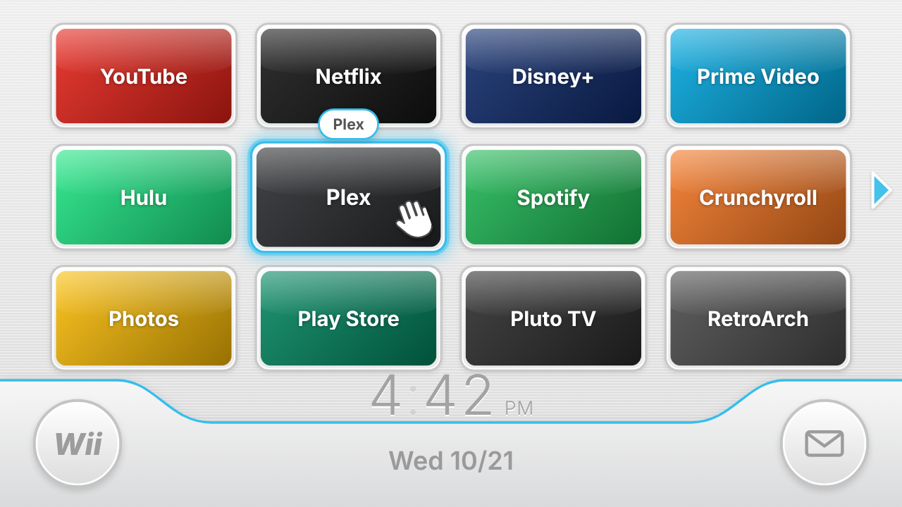
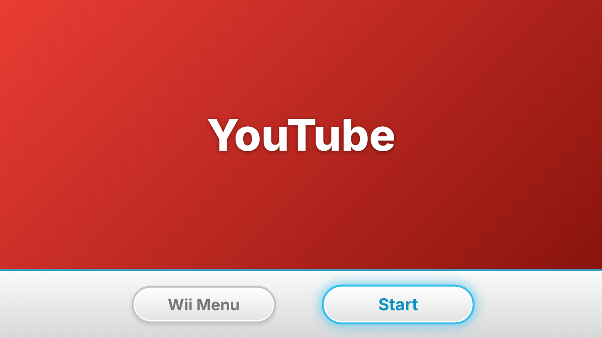

# Wii TV Launcher

A retro Wii-menu-style home screen for Android-based TV devices (onn. 4K / 4K Pro, other Google TV / Android TV boxes, Fire TV Stick). Your installed apps become channels on a 4×3 grid, with page arrows, a pointing hand that follows the selection, the clock and date in the bottom bar, a channel preview screen ("Wii Menu" / "Start"), menu sounds and background music.




It uses **Option A** from the project plan: the UI is plain HTML/CSS/JavaScript (no build step) in `web/`, packaged into a small native Android WebView wrapper in `android/` that:

- registers as a **HOME** launcher (and as a normal TV app),
- lists every launchable app and serves its TV banner or icon to the page,
- forwards the remote's D-pad / OK / BACK / MENU keys to the UI,
- launches apps and Android Settings,
- refreshes the channels when apps are installed or removed.

> Fan project, not affiliated with or endorsed by Nintendo. "Wii" is a Nintendo trademark. No Nintendo assets are included: everything is drawn with CSS/SVG, and all sounds and the background music are synthesized at runtime with the Web Audio API (`web/js/sound.js`). Inspired by [MauroProto/wii-tv](https://github.com/MauroProto/wii-tv), a native-Java take on the same idea.

## Layout

```
web/                    UI (runs on the TV and in any desktop browser)
  index.html
  css/style.css         Wii look: tiles, glow, bottom bar, panels
  js/app.js             screens, rendering, input handling
  js/nav.js             pure grid-navigation logic (unit tested)
  js/sound.js           synthesized SFX + background music
  js/bridge.js          window.WiiTV native bridge (+ mock apps in a browser)
  js/config.js          pinned/hidden apps, defaults  <- customise here
android/                Gradle project, package com.example.wiitv
  app/src/main/java/com/example/wiitv/
    MainActivity.java   full-screen WebView, key forwarding, HOME launcher
    WiiBridge.java      getApps / launchApp / openSettings for JavaScript
    AppArtHandler.java  serves app banners/icons as PNG to the page
    RemoteKeys.java     remote key code -> UI key name
scripts/deploy.sh       build + wireless ADB install + launch (+ set as home)
scripts/restore-home.sh undo the home-screen change
test/                   node --test unit tests for the navigation logic
```

The Gradle build copies `web/` into the APK's assets automatically, so you only ever edit `web/`.

## Try it in a browser

```bash
npm run dev            # serves web/ on http://localhost:8080
```

Use the arrow keys, Enter (OK), Esc/Backspace (BACK) and `M` (menu). In a browser the app list is mock data; the mouse works too.

## Build the APK

Requirements: JDK 17+ and the Android SDK (`platforms;android-34`, `build-tools;34.0.0`); Android Studio includes both. Point Gradle at the SDK with `ANDROID_HOME` or `android/local.properties` (`sdk.dir=/path/to/sdk`).

```bash
cd android
./gradlew assembleDebug
# -> android/app/build/outputs/apk/debug/app-debug.apk
```

CI (`.github/workflows/ci.yml`) runs the unit tests and builds the APK on every push; the APK is attached to each run as an artifact.

## Deploy to the TV over Wi-Fi (ADB)

1. **Enable developer mode on the TV.**
   - Google TV / onn.: Settings → System → About → select **Android TV OS build** 7 times. Then Settings → System → Developer options → **USB debugging** ON (and **Wireless debugging** if offered).
   - Fire TV: Settings → My Fire TV → About → select the device name 7 times. Then Developer options → **ADB debugging** ON (and **Apps from Unknown Sources** ON).
2. **Find the TV's IP**: Settings → Network (e.g. `192.168.1.50`).
3. **Build, install and launch** from the repo root:

   ```bash
   scripts/deploy.sh 192.168.1.50              # build, install, launch
   scripts/deploy.sh 192.168.1.50 --set-home   # ...and make it the home screen
   ```

   The first time, the TV asks to allow debugging from your computer: tick "Always allow" and accept.

   Equivalent manual commands:

   ```bash
   adb connect 192.168.1.50:5555
   adb install -r android/app/build/outputs/apk/debug/app-debug.apk
   adb shell am start -n com.example.wiitv/.MainActivity
   ```

> Note: on Google TV, newer builds use **Wireless debugging** with a pairing code and a random port instead of 5555. Run `adb pair <ip>:<pair-port>` with the code shown on the TV, then `scripts/deploy.sh <ip>:<port>`.

## Making it the home screen

The app declares a `HOME` intent filter, so Android can use it as the launcher.

- **Most Android TV / onn. devices:** `scripts/deploy.sh <ip> --set-home` runs `cmd package set-home-activity com.example.wiitv/.MainActivity`. Press HOME to check.
- **If HOME still opens the stock launcher** (some Google TV builds ignore third-party home apps), you can disable the stock launcher. This is reversible but you do it at your own risk:

  ```bash
  adb shell pm disable-user --user 0 com.google.android.apps.tv.launcherx   # Google TV
  ```

  Undo with `scripts/restore-home.sh <ip>` (or `adb shell pm enable <package>`).
- **Fire TV:** Fire OS doesn't let third-party apps replace the Amazon home screen, and disabling `com.amazon.tv.launcher` can leave the device unusable. On Fire TV, install Wii TV as a normal app and open it from **Your Apps**, or pin it to the front of the app row.

## Remote controls

| Key | Menu | Channel preview | Panels |
| --- | --- | --- | --- |
| D-pad | Move the hand. RIGHT on the last column / LEFT on the first column turns the page. DOWN from the bottom row goes to the round buttons. | Choose **Wii Menu** / **Start** | Move |
| OK | Open the channel / button | Activate | Activate |
| BACK | Jump to the first channel (or leave, if Wii TV isn't the home app) | Back to the menu | Close |
| MENU | Open the Wii TV menu | | Close |
| CH+/CH−, ⏪/⏩, L1/R1 | Previous / next page | | |

The **Wii** button opens the menu (music on/off, sounds on/off, refresh channels, Android TV Settings). The **envelope** opens the message board.

## Customise

| What | Where |
| --- | --- |
| Which apps come first, in what order | `pinned` in `web/js/config.js` (package names; the rest follow alphabetically) |
| Apps that never get a channel | `hidden` in `web/js/config.js` |
| Default music / sounds, volumes | `music`, `sounds`, `musicVolume`, `soundVolume` in `web/js/config.js` |
| Start-up notice screen | `bootScreen`, `bootScreenTimeoutMs`; text in `web/index.html` |
| Sounds and the music loop | `web/js/sound.js` |
| Colours and tile sizes | CSS variables at the top of `web/css/style.css` |
| Package name | `namespace`/`applicationId` in `android/app/build.gradle` (also update `scripts/`) |

Find package names with `adb shell pm list packages`. Rebuild and redeploy after changes.

## Tests

```bash
npm test
```
